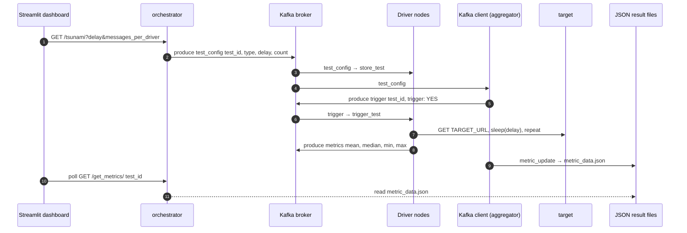
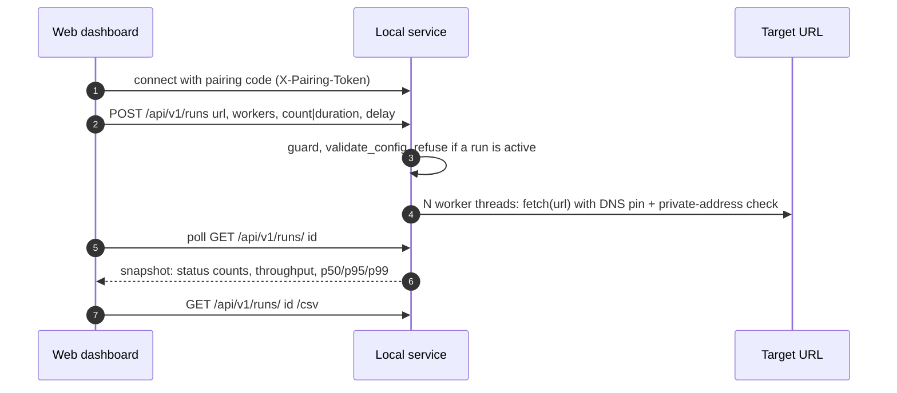
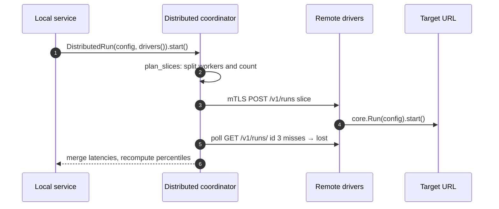

# distributed-load-testing — architecture

[https://github.com/KushShriv/Distributed-Load-Testing-System](https://github.com/KushShriv/Distributed-Load-Testing-System) · commit `30e1f9e` · 2026-11-13

**Interactive map:** https://kushshriv.github.io/strata/?map=distributed-load-testing

**Confidence 85%** (High) — Read every entry point, all Kafka topics and HTTP routes, and the local/remote run path. 'Legacy' label for the prototype rests on git history and README wording.  
_How likely the map matches the code. High 80–100 = read in code; Med 50–79 = some inference; Low < 50 = mostly unverified._

## L0 — Overview

**Two separate systems in one repo: the original university prototype (Flask + Kafka + Streamlit) and a newer stdlib-only local load tester with optional mutual-TLS remote drivers.**

A load-testing tool that fires HTTP requests at a target and reports latency. The 2024 prototype coordinates driver processes through five Kafka topics and keeps results in JSON files read by a Flask orchestrator and a Streamlit dashboard. The 2026 rewrite runs as one Python process on 127.0.0.1 behind a pairing token, uses worker threads per run, and can split a run across remote drivers over mutual TLS. The two systems share no runtime path.

Stack: Python · Flask · Kafka (kafka-python) · Streamlit · http.server (stdlib) · TLS 1.2+ mTLS · Static HTML dashboard

| Entry point | Role |
|---|---|
| `start.sh` | Creates .venv, starts local_service.py |
| `local_service.py:257` | Local service main: 127.0.0.1:8765, prints pairing code |
| `remote_driver.py:101` | Optional remote driver (mTLS, explicit --bind) |
| `orchestrator.py:24` | Prototype: Flask /tsunami and /avalanche |
| `driver.py:127` | Prototype: driver node process |
| `kafka-client.py:98` | Prototype: topic consumer and result writer |
| `frontend.py` | Prototype: Streamlit dashboard |
| `target.py:14` | Prototype: sample target server :8080 |

## L1 — System

- **Kafka prototype (university)** (legacy): Orchestrator, drivers and an aggregator talk only through Kafka; results live in JSON files. _Status basis: README calls it the original university prototype; its files were last changed 2024-07-20 (7544ac3) while start.sh launches only local_service.py._
- **Local load tester** (active): One stdlib Python service on 127.0.0.1 with a token-paired web dashboard and optional mTLS drivers. _Status basis: start.sh execs local_service.py; changed 2026-11-12._

```mermaid
flowchart LR
  subgraph s_n0["Kafka prototype (university)"]
    n0["Streamlit dashboard"]
    n1["Orchestrator"]
    n2["Kafka broker"]
    n3["Kafka client (aggregator)"]
    n4["Driver nodes"]
    n5["Sample target"]
    n6["JSON result files"]
  end
  subgraph s_n7["Local load tester"]
    n7["Web dashboard"]
    n8["Local service"]
    n9["Distributed coordinator"]
    n10["Remote drivers"]
    n11["Release + cert tooling"]
  end
    n12["Target URL"]
  n0 -->|GET /tsunami, /avalanche, /get_metrics, | n1
  n1 -->|produce test_config| n2
  n3 -->|consume all topics  produce trigger| n2
  n4 -->|consume test_config/trigger  produce reg| n2
  n4 -->|GET TARGET_URL, time each request| n5
  n3 -->|write metrics + node status| n6
  n1 -->|read| n6
  n7 -->|/api/v1/runs (X-Pairing-Token)| n8
  n8 -->|worker threads fetch(url)| n12
  n8 -->|POST /api/v1/distributed-runs| n9
  n9 -->|mTLS: POST /v1/runs slice, poll GET /v1/| n10
  n10 -->|same Run workers| n12
```

| Component | Kind | Tech | Job | Entry |
|---|---|---|---|---|
| Streamlit dashboard | frontend | Streamlit + pandas | Pages for metrics, node status and test config; polls the orchestrator. | `frontend.py` |
| Orchestrator | service | Flask :5000 | Starts tsunami/avalanche tests by publishing test_config; serves results read from JSON files. | `orchestrator.py:24` |
| Kafka broker | queue | localhost:9092 · topics register, test_config, trigger, metrics, heartbeat | The only channel between orchestrator, aggregator and drivers. |  |
| Kafka client (aggregator) | worker | kafka-python, 2 threads | Consumes every topic, turns test_config into trigger, records nodes and metrics to JSON files. | `kafka-client.py:98` |
| Driver nodes | worker | Python process × N | Register, send heartbeats, run tsunami (fixed delay) or avalanche (no delay) tests and publish latency metrics. | `driver.py:127` |
| Sample target | service | Flask :8080 | /ping endpoint to load-test and a /metrics counter. | `target.py:14` |
| JSON result files | store | metric_data.json, driver_nodes.json | Shared files: written by the aggregator, read by the orchestrator. Both must run in the same directory. |  |
| Web dashboard | frontend | Static HTML/JS (served at / and on GitHub Pages) | Pair with the code from the terminal, start or cancel a run, poll results, export CSV. Calls http://127.0.0.1:8765. | `docs/index.html:12` |
| Local service | service | ThreadingHTTPServer 127.0.0.1:8765 | Pairing-token and Host/Origin checks, one active run at a time, worker threads that time requests and compute p50/p95/p99. | `local_service.py:246` |
| Distributed coordinator | library | distributed.py (in-process) | Splits workers and count across drivers, starts slices, polls them, marks lost drivers, merges latencies. | `distributed.py:70` |
| Remote drivers | worker | HTTPS mTLS, explicit --bind | Optional. Runs one slice with the same Run class as the local service; rejects clients without a CA-signed cert. | `remote_driver.py:101` |
| Release + cert tooling | infra | build_release.py, make_certs.sh | Packs a release tarball; creates a private CA and driver/client certs for mTLS. |  |
| Target URL | external | any http(s) URL | The system under test. Private or local addresses need explicit confirmation. |  |

## L2 — Modules

| Module | Component | Symbols | In | Out | Key symbols |
|---|---|---|---|---|---|
| `local_service` | Local service | 27 | 3 | 5 | `.do_POST() (local_service.py:L214)`<br>`Handler (local_service.py:L159)`<br>`Run (local_service.py:L91)` |
| `distributed` | Distributed coordinator | 13 | 5 | 0 | `DistributedRun (distributed.py:L70)`<br>`Driver (distributed.py:L33)`<br>`.__init__() (distributed.py:L71)` |
| `remote_driver` | Remote drivers | 12 | 0 | 3 | `DriverHandler (remote_driver.py:L43)`<br>`.do_POST() (remote_driver.py:L73)`<br>`DriverServer (remote_driver.py:L28)` |
| `driver` | Driver nodes | 7 | 0 | 0 | `trigger_test() (driver.py:L95)`<br>`kafka_consume_messages() (driver.py:L115)`<br>`avalanche_test() (driver.py:L69)` |
| `kafka-client` | Kafka client (aggregator) | 6 | 0 | 0 | `kafka_consume_messages() (kafka-client.py:L77)`<br>`heartbeat() (kafka-client.py:L40)`<br>`metric_update() (kafka-client.py:L63)` |
| `orchestrator` | orchestrator | 6 | 0 | 0 | `avalanche_test() (orchestrator.py:L46)`<br>`get_metrics() (orchestrator.py:L66)`<br>`get_nodes_data() (orchestrator.py:L83)` |
| `frontend` | Streamlit dashboard | 5 | 0 | 0 | `req() (frontend.py:L77)`<br>`results() (frontend.py:L60)`<br>`view_metrics() (frontend.py:L16)` |
| `target` | target | 3 | 0 | 0 | `metrics() (target.py:L21)`<br>`ping() (target.py:L15)` |
| `make_certs` | Release + cert tooling | 3 | 0 | 0 | `mk() (make_certs.sh:L13)`<br>`make_certs.sh script (make_certs.sh:L1)` |
| `build_release` | Release + cert tooling | 2 | 0 | 0 | `build() (build_release.py:L17)` |
| `start` |  | 2 | 0 | 0 | `start.sh script (start.sh:L1)` |

## L3 — Flows

### Tsunami test (Kafka prototype)
Trigger: `Streamlit → GET /tsunami`



| # | Step | Evidence |
|---|---|---|
| 1 | Streamlit dashboard → orchestrator: GET /tsunami?delay&messages_per_driver | `frontend.py:97` |
| 2 | orchestrator → Kafka broker: produce test_config {test_id, type, delay, count} | `orchestrator.py:38` |
| 3 | Kafka broker → Driver nodes: test_config → store_test | `driver.py:120` |
| 4 | Kafka broker → Kafka client (aggregator): test_config | `kafka-client.py:87` |
| 5 | Kafka client (aggregator) → Kafka broker: produce trigger {test_id, trigger: YES} | `kafka-client.py:93` |
| 6 | Kafka broker → Driver nodes: trigger → trigger_test | `driver.py:122` |
| 7 | Driver nodes → target: GET TARGET_URL, sleep(delay), repeat | `driver.py:48` |
| 8 | Driver nodes → Kafka broker: produce metrics {mean, median, min, max} | `driver.py:65` |
| 9 | Kafka client (aggregator) → JSON result files: metric_update → metric_data.json | `kafka-client.py:63` |
| 10 | Streamlit dashboard → orchestrator: poll GET /get_metrics/<test_id> | `frontend.py:65` |
| 11 | orchestrator → JSON result files: read metric_data.json | `orchestrator.py:76` |

### Local run
Trigger: `POST /api/v1/runs`



| # | Step | Evidence |
|---|---|---|
| 1 | Web dashboard → Local service: connect with pairing code (X-Pairing-Token) | `docs/index.html:16` |
| 2 | Web dashboard → Local service: POST /api/v1/runs {url, workers, count|duration, delay} | `docs/index.html:18` |
| 3 | Local service → Local service: guard, validate_config, refuse if a run is active | `local_service.py:222` |
| 4 | Local service → Target URL: N worker threads: fetch(url) with DNS pin + private-address check | `local_service.py:111` |
| 5 | Web dashboard → Local service: poll GET /api/v1/runs/<id> | `docs/index.html:19` |
| 6 | Local service → Web dashboard: snapshot: status counts, throughput, p50/p95/p99 | `local_service.py:134` |
| 7 | Web dashboard → Local service: GET /api/v1/runs/<id>/csv | `docs/index.html:23` |

### Distributed run (remote drivers)
Trigger: `POST /api/v1/distributed-runs (DLT_DRIVERS set)`



| # | Step | Evidence |
|---|---|---|
| 1 | Local service → Distributed coordinator: DistributedRun(config, drivers()).start() | `local_service.py:235` |
| 2 | Distributed coordinator → Distributed coordinator: plan_slices: split workers and count | `distributed.py:57` |
| 3 | Distributed coordinator → Remote drivers: mTLS POST /v1/runs slice | `distributed.py:87` |
| 4 | Remote drivers → Target URL: core.Run(config).start() | `remote_driver.py:86` |
| 5 | Distributed coordinator → Remote drivers: poll GET /v1/runs/<id>; 3 misses → lost | `distributed.py:102` |
| 6 | Distributed coordinator → Local service: merge latencies, recompute percentiles | `distributed.py:120` |

## L4 — Deep dives

### Local service: request guard and SSRF limits

#### Why it matters
The service fires HTTP requests at user-supplied URLs from your machine, and its dashboard can be opened from GitHub Pages. Both are abuse paths.

#### Controls seen in code
| Control | Where |
|---|---|
| Binds `127.0.0.1` only | `local_service.py:246` |
| Exactly one `Host` header, must be `127.0.0.1:<port>` or `localhost:<port>` | `local_service.py:173` |
| Origin allow-list: local origins + `https://kushshriv.github.io` | `local_service.py:169-171` |
| Pairing token (`X-Pairing-Token`), compared with `hmac.compare_digest` | `local_service.py:182-184` |
| Single `Content-Length`, no chunked bodies, 8 KB cap | `local_service.py:217-221` |
| One active run; max 20 kept | `local_service.py:224-226` |
| Target DNS resolved once and pinned; non-global address refused unless confirmed | `local_service.py:62-69` |

#### Remote drivers
- Server side requires a client cert from the private CA (`CERT_REQUIRED`), TLS ≥ 1.2 (`remote_driver.py:19-25`).
- `--bind` has no default, so a driver never listens on all interfaces by accident (`remote_driver.py:103`).
- Coordinator accepts only `https://host:port` driver URLs (`distributed.py:36`).

#### Open questions
- Distributed runs have an API but the dashboard shows no control for them (inference: only one mention of "distributed" in `docs/index.html`, in prose).

## Not visible from code

- The AST graph shows no edges between prototype processes: they meet only through Kafka topics and shared JSON files, found by grep.
- The remote_driver → local_service graph edge is a code import (reuse of Run and validate_config), not a runtime call.
- docs/index.html is not parsed by the graph; its API calls were read directly.
- Whether the prototype still runs against a current Kafka was not checked.

## Next zoom

- L4: Run worker accounting — claimed/completed counters and duration cut-off (local_service.py:111-133).
- L4: percentile merge across drivers vs. per-driver sampling caps (distributed.py:120-136).
- Decide whether to delete or archive the prototype; build_release.py still ships its files.

---
Generated by [Strata](https://github.com/KushShriv/strata).