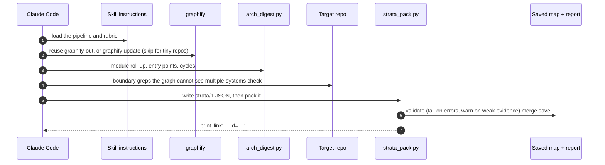
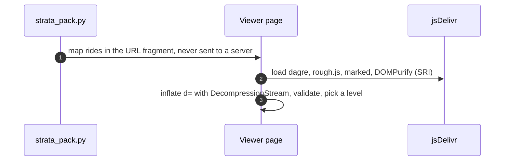
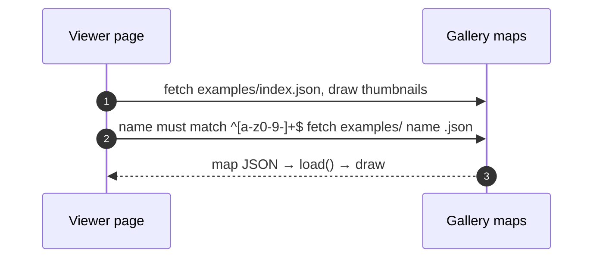

# strata — architecture

[https://github.com/KushShriv/strata](https://github.com/KushShriv/strata) · commit `210cd6d` · 2026-11-13

**Interactive map:** https://kushshriv.github.io/strata/?map=strata

**Confidence 85%** (High) — Read SKILL.md, both scripts' entry points, validation and output code, and the viewer's load, render and share code. graphify itself is an external tool and was not read; its behaviour comes from SKILL.md and from running it this session. Claude Code's steps follow SKILL.md, which is an instruction file, not code.  
_How likely the map matches the code. High 80–100 = read in code; Med 50–79 = some inference; Low < 50 = mostly unverified._

## L0 — Overview

**Two separate systems that share only a JSON format: a Claude Code skill (instructions + two Python scripts) and a static viewer on GitHub Pages.**

Strata maps a repository's architecture at five zoom levels, from a one-line overview (L0) to symbol-level deep dives (L4). The skill tells Claude Code to build a free AST graph with graphify, roll it up with arch_digest.py, check every boundary claim against the code, and write a strata/1 JSON. strata_pack.py validates that JSON (including the confidence score), saves it, writes an optional Markdown report and prints a link. The link carries the whole map in the URL fragment, so no server ever sees it. The viewer is plain JavaScript that draws the map by hand-drawn style with dagre and rough.js.

Stack: Markdown skill (Claude Code) · Python 3 stdlib · graphify (AST graph) · vanilla JS · dagre + rough.js · marked + DOMPurify · GitHub Pages

| Entry point | Role |
|---|---|
| `skill/SKILL.md` | /strata: the pipeline Claude Code follows |
| `skill/scripts/arch_digest.py` | repo recon + graph roll-up |
| `skill/scripts/strata_pack.py` | validate, save, report, link |
| `docs/index.html` | viewer page |
| `install.sh` | links skill/ into ~/.claude/skills/strata |

## L1 — System

- **Analysis skill** (active): Runs on the user's machine. Reads a repo and writes a map. _Status basis: install.sh:15 links skill/ into ~/.claude/skills/strata._
- **Viewer** (active): Runs in the browser. Draws a map from a link, a file or the gallery. _Status basis: docs/ holds index.html and .nojekyll; the site serves it._

```mermaid
flowchart LR
    n0["Claude Code"]
    n2["graphify"]
    n3["Target repo"]
    n9["jsDelivr"]
  subgraph s_n1["Analysis skill"]
    n1["Skill instructions"]
    n4["arch_digest.py"]
    n5["strata_pack.py"]
    n6["Saved map + report"]
  end
  subgraph s_n7["Viewer"]
    n7["Viewer page"]
    n8["Gallery maps"]
  end
  n0 -->|reads the pipeline| n1
  n0 -->|graphify update  repo| n2
  n2 -->|parse → graphify-out/| n3
  n0 -->|python3 arch_digest.py| n4
  n4 -->|read graph.json + walk files| n3
  n0 -->|grep boundaries, read code| n3
  n0 -->|python3 strata_pack.py| n5
  n5 -->|write JSON (+ --md)| n6
  n5 -->|link with  d= deflate+base64url| n7
  n6 -->|drop or paste file (read locally)| n7
  n7 -->|fetch ?map= name| n8
  n7 -->|4 scripts, SRI-checked| n9
```

| Component | Kind | Tech | Job | Entry |
|---|---|---|---|---|
| Claude Code | external | agent | Follows SKILL.md: runs the tools, reads code, writes the JSON and the answer. |  |
| Skill instructions | library | Markdown | Levels, the six-step pipeline, the multiple-systems check, the confidence rubric and the JSON schema. | `skill/SKILL.md:1` |
| graphify | external | CLI, AST only | Builds graphify-out/graph.json with no LLM and no network. |  |
| Target repo | external | any language | The repository being mapped. |  |
| arch_digest.py | cli | Python stdlib | Languages, manifests and entry points, then a module roll-up of the graph with fan-in/out, cycles and key symbols. | `skill/scripts/arch_digest.py:242` |
| strata_pack.py | cli | Python stdlib | Validates the JSON and its confidence block, merges with a saved map, writes the report and prints the share link. | `skill/scripts/strata_pack.py:274` |
| Saved map + report | store | ~/.strata/<name>.json, ARCHITECTURE.md | The validated map, merged with earlier runs, and an optional Markdown report with mermaid diagrams. |  |
| Viewer page | frontend | vanilla JS, strict CSP | Loads a map, then draws L0 cards, L1/L2 graphs, L3 sequences and L4 Markdown. | `docs/app.js:92` |
| Gallery maps | store | docs/examples/*.json | Published maps and the gallery list. |  |
| jsDelivr | external | pinned versions + SRI | dagre, rough.js, marked and DOMPurify. |  |

## L2 — Modules

| Module | Component | Symbols | In | Out | Key symbols |
|---|---|---|---|---|---|
| `docs/app.js` | Viewer page | 34 | 0 | 2 | `boot() (docs/app.js:L92)`<br>`load() (docs/app.js:L76)`<br>`setLevel() (docs/app.js:L138)` |
| `docs/draw.js` | Viewer page | 20 | 1 | 0 | `graph() (docs/draw.js:L143)`<br>`sequence() (docs/draw.js:L308)`<br>`palette() (docs/draw.js:L52)` |
| `docs/theme.js` | Viewer page | 1 | 1 | 0 | `themechange event (docs/theme.js:L8)` |
| `arch_digest.py` | arch_digest.py |  | 0 | 0 | `digest_graph() (skill/scripts/arch_digest.py:L163)`<br>`list_files() (skill/scripts/arch_digest.py:L56)`<br>`noise() (skill/scripts/arch_digest.py:L144)` |
| `strata_pack.py` | strata_pack.py |  | 0 | 0 | `validate() (skill/scripts/strata_pack.py:L85)`<br>`check_confidence() (skill/scripts/strata_pack.py:L51)`<br>`from_digest() (skill/scripts/strata_pack.py:L128)` |
| `SKILL.md` | Skill instructions |  | 0 | 2 |  |
| `references/` | Skill instructions |  | 1 | 0 |  |

## L3 — Flows

### Map a repo (/strata)
Trigger: `/strata <repo> --level all`



| # | Step | Evidence |
|---|---|---|
| 1 | Claude Code → Skill instructions: load the pipeline and rubric | `skill/SKILL.md:37` |
| 2 | Claude Code → graphify: reuse graphify-out, or graphify update (skip for tiny repos) | `skill/SKILL.md:44` |
| 3 | Claude Code → arch_digest.py: module roll-up, entry points, cycles | `skill/SKILL.md:53` |
| 4 | Claude Code → Target repo: boundary greps the graph cannot see; multiple-systems check | `skill/SKILL.md:60` |
| 5 | Claude Code → strata_pack.py: write strata/1 JSON, then pack it | `skill/SKILL.md:107` |
| 6 | strata_pack.py → Saved map + report: validate (fail on errors, warn on weak evidence); merge; save | `skill/scripts/strata_pack.py:295` |
| 7 | strata_pack.py → Claude Code: print 'link: …#d=…' | `skill/scripts/strata_pack.py:316` |

### Open a shared link
Trigger: `https://kushshriv.github.io/strata/#d=…`



| # | Step | Evidence |
|---|---|---|
| 1 | strata_pack.py → Viewer page: map rides in the URL fragment, never sent to a server | `skill/scripts/strata_pack.py:305` |
| 2 | Viewer page → jsDelivr: load dagre, rough.js, marked, DOMPurify (SRI) | `docs/index.html:118` |
| 3 | Viewer page → Viewer page: inflate #d= with DecompressionStream, validate, pick a level | `docs/app.js:98` |

### Open a gallery map
Trigger: `?map=<name>`



| # | Step | Evidence |
|---|---|---|
| 1 | Viewer page → Gallery maps: fetch examples/index.json, draw thumbnails | `docs/app.js:338` |
| 2 | Viewer page → Gallery maps: name must match ^[a-z0-9-]+$; fetch examples/<name>.json | `docs/app.js:99` |
| 3 | Gallery maps → Viewer page: map JSON → load() → draw | `docs/app.js:104` |

## L4 — Deep dives

### Share links with no server

#### Encoding
`strata_pack.py` dumps the JSON compactly, compresses it with **raw deflate** (`zlib.compressobj(9, DEFLATED, -15)`) and encodes it as unpadded **base64url** (`strata_pack.py:302-306`). The link is `<viewer>#d=<data>` (`:307`).

#### Why the fragment
Browsers do not send the part after `#` to the server, so GitHub Pages never receives the map. The viewer decodes it with the browser's `DecompressionStream('deflate-raw')` (`docs/app.js:61`).

#### Limits
| Limit | Where |
|---|---|
| Links over 60,000 chars are not printed; drop the file instead | `strata_pack.py:34`, `:313` |
| The report embeds the link only when it is under 2,000 chars | `strata_pack.py:311` |

#### Other sources
`?map=` accepts only `[a-z0-9-]` names from `examples/` (`docs/app.js:99`). `?src=` accepts https or same-origin URLs only, and fetches with no credentials and no referrer (`docs/app.js:101-103`).

### Rendering untrusted maps

A map can come from anyone, so the viewer treats it as hostile.

| Control | Where |
|---|---|
| CSP: scripts only from self and jsDelivr; no inline script; `object-src 'none'`; `base-uri 'none'` | `docs/index.html:8` |
| Pinned library versions with SRI hashes | `docs/index.html:118-121` |
| Text goes in through `textContent` via `el()` | `docs/app.js:22` |
| Raw HTML in Markdown is escaped before parsing | `docs/app.js:19` |
| Parsed Markdown is sanitised; `style`, `form`, `input` and style attributes removed | `docs/app.js:323` |
| JSON shape is checked before drawing | `docs/app.js:67` |

The escape step matters: without it, raw `` would reach DOMPurify's parser, and only the CSP would stop it.

### The confidence check

The rubric is in `SKILL.md`. `check_confidence()` (`strata_pack.py:51`) enforces the parts a script can see.

**Errors (pack fails):** no score, score not an integer 0–100, label not matching the band (High 80–100, Med 50–79, Low 0–49), or no basis.

**Warnings:** the share of links and flow steps with no evidence or with `inferred: true` is over 20% while the score is High, or over 50% while it is Med (`strata_pack.py:76-82`).

The check cannot tell whether the evidence lines are correct; that still depends on the verification step.

## Not visible from code

- The graph has no links between the viewer scripts: they share window.StrataDraw and a DOM event, not imports. Module links were counted by grep.
- Claude Code's steps come from SKILL.md, an instruction file. The scripts are code; the agent's behaviour is not.
- graphify is an external tool; its internals were not read.
- This map describes commit 210cd6d, before it was added to its own gallery.

## Next zoom

- L4: draw.js layout — cluster separation, loose-node grid and the LR/TB choice (docs/draw.js:143).
- L4: arch_digest.py auto-expand and noise filters (skill/scripts/arch_digest.py:144-162).

---
Generated by [Strata](https://github.com/KushShriv/strata).