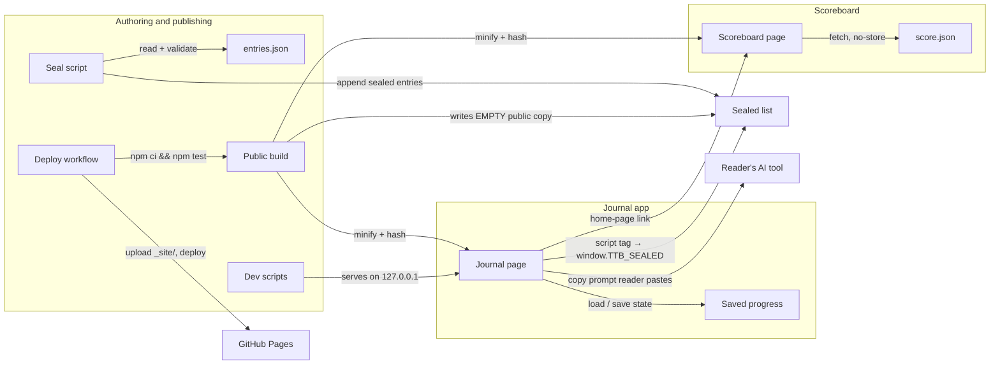
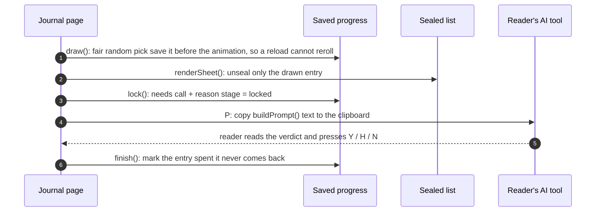
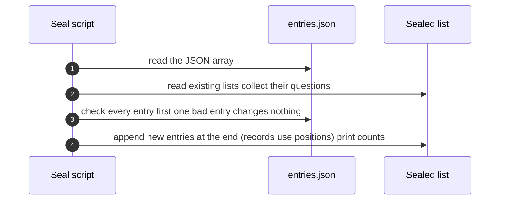
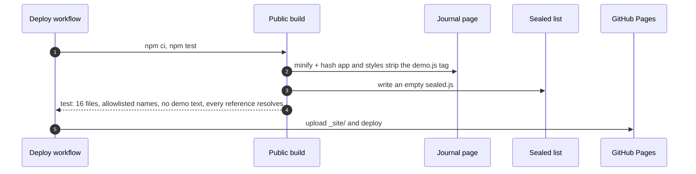
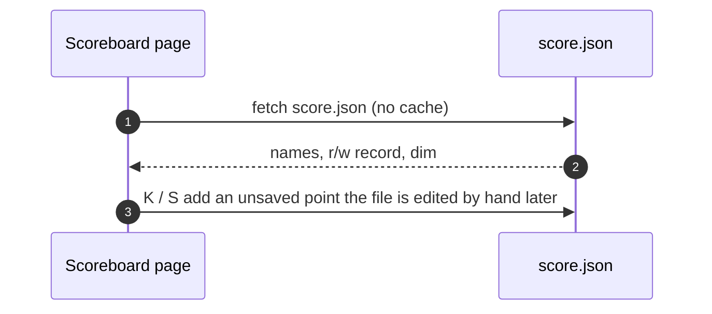

# the-thinking-behind — architecture

[https://github.com/KushShriv/the-thinking-behind](https://github.com/KushShriv/the-thinking-behind) · commit `f796781` · 2026-11-13

**Interactive map:** https://kushshriv.github.io/strata/?map=the-thinking-behind

**Confidence 85%** (High) — Read seal.mjs, build.mjs, build.test.mjs and the deploy workflow in full, and the state, draw, lock, prompt and copy code in app.js and the load and key code in scoreboard/app.js. Not read: styles and animation code. demo.js is git-ignored, so its content is unknown. The AI step is a manual paste; the code only writes the clipboard.  
_How likely the map matches the code. High 80–100 = read in code; Med 50–79 = some inference; Low < 50 = mostly unverified._

## L0 — Overview

**Two static browser pages (the journal and a camera scoreboard) plus offline Node scripts that seal the content and build the public site. No server.**

A decision-practice tool and a prop for videos. Classic mode shows a real story that stops before the decision. The reader writes a call and a reason, and the page builds a coaching prompt to paste into any AI tool; the page never gives the answer. Arcade mode is a quick quiz that shows the answer and sources after the guess is locked. All progress stays in localStorage. Entries come from a sealed list (XOR with a fixed key, then base64; this hides entries from accidental reading, it is not encryption) that seal.mjs writes and that is never deployed: the public build ships an empty list. A separate scoreboard page reads score.json and is filmed behind the presenter.

Stack: JavaScript (no framework, no runtime deps) · HTML + CSS · Web Animations + View Transitions · localStorage · Node 22 + esbuild (build only) · GitHub Actions → GitHub Pages

| Entry point | Role |
|---|---|
| `index.html` | journal page; loads sealed.js, demo.js (local only) and app.js |
| `scoreboard/index.html` | scoreboard page |
| `seal.mjs` | node seal.mjs entries.json: adds entries to sealed.js |
| `build.mjs` | npm run build / npm test: writes the public _site/ |
| `start.sh` | local preview on 127.0.0.1:8765 (python http.server) |

## L1 — System

- **Journal app** (active): The Classic and Arcade practice page. Runs fully in the browser. _Status basis: index.html:12 loads app.js; deploy.yml publishes it._
- **Scoreboard** (active): A full-screen match board filmed behind the presenter. _Status basis: own index.html and app.js; it shares no code or state with the journal, only a link._
- **Authoring and publishing** (active): Scripts that seal entries, build and test the public site, and preview it locally. _Status basis: deploy.yml runs on push to main._

| Component | Kind | Tech | Job | Entry |
|---|---|---|---|---|
| Journal page | frontend | vanilla JS IIFE | Draws an entry at random, takes the reader's call and reason, builds the AI prompt, and records the verdict. | `app.js:1` |
| Saved progress | store | localStorage 'ttb-modes' | Per mode: the open entry, its stage and drafts, and the spent entries. Lets a reload return to the same entry. |  |
| Sealed list | store | sealed.js → window.TTB_SEALED | Classic and Arcade entries, each XOR-ed with 'the-thinking-behind' and base64-encoded. Git-ignored; the public build writes an empty one. |  |
| Reader's AI tool | external | any chat AI | Gets the coaching prompt by a manual paste. The page has no API call. |  |
| Seal script | cli | Node ESM | Checks every entry first, skips duplicate questions, and appends the rest to the sealed list. Prints counts only. | `seal.mjs:1` |
| entries.json | store | JSON, git-ignored | The plain-text input to the seal script. The README says to delete it after sealing. |  |
| Public build | cli | esbuild 0.25 + node:test | Copies an allowlist into _site/, minifies, adds content hashes, drops demo.js, and writes an empty sealed list. The test checks the file list and every asset reference. | `build.mjs:16` |
| Deploy workflow | infra | GitHub Actions | On push to main: npm ci, npm test, then upload _site/ to Pages. |  |
| GitHub Pages | external | static hosting | Serves the app at the root and the scoreboard at /scoreboard/. |  |
| Dev scripts | cli | bash + Python http.server | setup.sh installs graphify in .venv; start.sh and stop.sh run a local preview with a saved PID. | `start.sh:9` |
| Scoreboard page | frontend | vanilla JS + Web Audio | Shows the player-vs-sources record. K and S add unsaved points with a bell or buzzer for filming. | `scoreboard/app.js:1` |
| score.json | store | JSON | Names, the r/w guess record and screen dimming. |  |

## L2 — Modules

| Module | Component | Symbols | In | Out | Key symbols |
|---|---|---|---|---|---|
| `app.js` | Journal page | 48 | 0 | 0 | `draw() (app.js:L529)` `renderSheet() (app.js:L251)` `buildPrompt() (app.js:L44)` |
| `seal.mjs` | Seal script | 15 | 0 | 0 | `problem() (seal.mjs:L33)` `seal() (seal.mjs:L24)` `unseal() (seal.mjs:L25)` |
| `build.mjs` | Public build | 6 | 1 | 0 | `build() (build.mjs:L16)` `emit() (build.mjs:L21)` |
| `build.test.mjs` | Public build | 1 | 0 | 1 | `public build test (build.test.mjs:L6)` |
| `scoreboard/app.js` | Scoreboard page | 27 | 0 | 0 | `read() (scoreboard/app.js:L154)` `draw() (scoreboard/app.js:L121)` `fit() (scoreboard/app.js:L104)` |
| `start.sh` | Dev scripts | 2 | 0 | 0 |  |
| `stop.sh` | Dev scripts | 2 | 0 | 0 |  |
| `setup.sh` | Dev scripts | 2 | 0 | 0 |  |

## L3 — Flows

### Play a Classic entry
Trigger: `Space on the journal`

| # | Step | Evidence |
|---|---|---|
| 1 | Journal page → Saved progress: draw(): fair random pick; save it before the animation, so a reload cannot reroll | `app.js:536` |
| 2 | Journal page → Sealed list: renderSheet(): unseal only the drawn entry | `app.js:253` |
| 3 | Journal page → Saved progress: lock(): needs call + reason; stage = locked | `app.js:640` |
| 4 | Journal page → Reader's AI tool: P: copy buildPrompt() text to the clipboard | `app.js:737` |
| 5 | Reader's AI tool → Journal page: reader reads the verdict and presses Y / H / N | `app.js:697` |
| 6 | Journal page → Saved progress: finish(): mark the entry spent; it never comes back | `app.js:598` |

### Add entries to the list
Trigger: `node seal.mjs entries.json`

| # | Step | Evidence |
|---|---|---|
| 1 | Seal script → entries.json: read the JSON array | `seal.mjs:55` |
| 2 | Seal script → Sealed list: read existing lists; collect their questions | `seal.mjs:64` |
| 3 | Seal script → entries.json: check every entry first; one bad entry changes nothing | `seal.mjs:67` |
| 4 | Seal script → Sealed list: append new entries at the end (records use positions); print counts | `seal.mjs:83` |

### Publish to GitHub Pages
Trigger: `push to main`

| # | Step | Evidence |
|---|---|---|
| 1 | Deploy workflow → Public build: npm ci, npm test | `.github/workflows/deploy.yml:33` |
| 2 | Public build → Journal page: minify + hash app and styles; strip the demo.js tag | `build.mjs:50` |
| 3 | Public build → Sealed list: write an empty sealed.js | `build.mjs:64` |
| 4 | Public build → Deploy workflow: test: 16 files, allowlisted names, no demo text, every reference resolves | `build.test.mjs:11` |
| 5 | Deploy workflow → GitHub Pages: upload _site/ and deploy | `.github/workflows/deploy.yml:36` |

### Film a score change
Trigger: `K or S on the scoreboard`

| # | Step | Evidence |
|---|---|---|
| 1 | Scoreboard page → score.json: fetch score.json (no cache) | `scoreboard/app.js:156` |
| 2 | score.json → Scoreboard page: names, r/w record, dim | `scoreboard/app.js:162` |
| 3 | Scoreboard page → score.json: K / S add an unsaved point; the file is edited by hand later | `scoreboard/app.js:214` |

## L4 — Deep dives

### The sealed list

#### What it is
Each entry is `JSON.stringify`-ed, XOR-ed byte by byte with the key `the-thinking-behind`, then base64-encoded (`seal.mjs:23-24`). The page has the same key and decodes **one entry only when it is drawn** (`unseal()`, `app.js:37`).

#### What it protects against
Accidental reading. The key is in the page source, so anyone can decode the list. The README says so. The real protection is that the list is **never published**:

| Guard | Where |
|---|---|
| `sealed.js` and `entries.json` are git-ignored | `.gitignore:2-3` |
| The build copies an allowlist, never the repo | `build.mjs:9` |
| The build writes an empty `window.TTB_SEALED` | `build.mjs:64` |
| The test fails on any other file name or on demo text | `build.test.mjs:12-28` |

#### Why positions matter
Progress is stored by entry **index** (`spent[index]`, `app.js:598`). So `seal.mjs` only appends, and de-duplicates by a normalised question (`seal.mjs:26`, `:64`). Reordering the list would mark the wrong entries as used.

#### Consequence
The public site shows an empty state in both modes until a reviewed public list exists (README).

### Fair draw, no rerolls

#### Pick
`randomInt()` (`app.js:116`) uses `crypto.getRandomValues` with **rejection sampling**: it drops values above the largest multiple of the pool size, so every remaining entry has the same chance.

#### Commit before showing
`draw()` writes `current = {index, stage: 'open'}` to localStorage **before** the book or level-reel animation starts (`app.js:535-537`). A reload during the animation returns to the same entry (`showView()`, `app.js:526`).

#### Stages
`open → locked → verdict → card` for Classic and `open → answer → card` for Arcade. Every move goes through `stageIs()` (`app.js:605`) and is saved at once.

| Action | Guard |
|---|---|
| Skip | two presses within 3 s; only while `open` (`app.js:607`) |
| Lock | needs both call and reason (`app.js:633`) |
| Finish | records `rejected`, `closed`, `got` or `missed`, clears `current` (`app.js:594`) |

After lock there is no path back to `open`, so a topic cannot be rejected once seen.

## Not visible from code

- The graph has no links between files: the browser scripts share globals (window.TTB_SEALED, window.TTB_STORE_KEY), not imports. Links were found by reading the code.
- demo.js is git-ignored, so its content and how it sets TTB_STORE_KEY were not seen.
- The AI step is a manual paste by the reader; nothing in the code calls an AI.

## Next zoom

- L4: motion — bookTimeline, runLevelReel, powerOn/powerOff (app.js:367-470).
- L4: keyboard map in the keydown handler (app.js:770).

---
Generated by [Strata](https://github.com/KushShriv/strata).