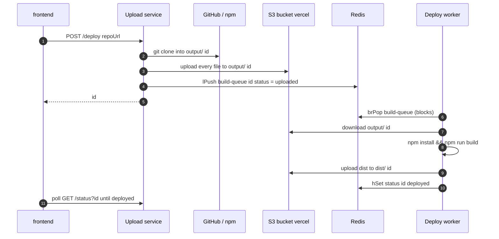
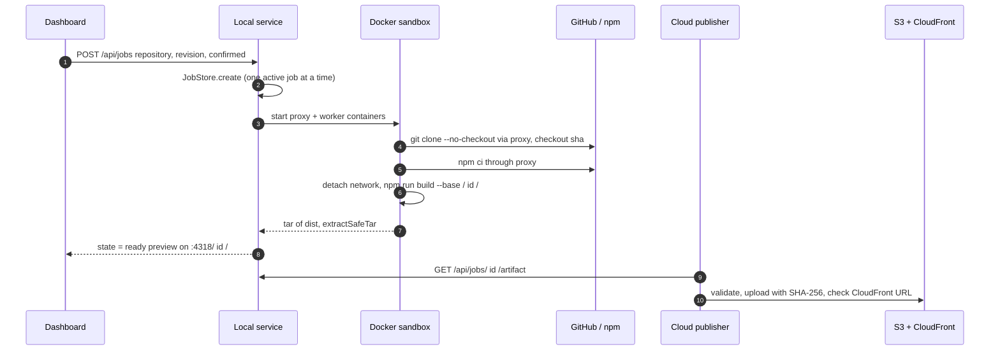

# vercel-clone — architecture

[https://github.com/KushShriv/Vercel-Clone-for-React-Projects](https://github.com/KushShriv/Vercel-Clone-for-React-Projects) · commit `f673ab0` · 2026-11-13

**Interactive map:** https://kushshriv.github.io/strata/?map=vercel-clone

**Confidence:** High 85 — Read all entry points, ports, Redis/S3 calls and cross-runtime HTTP links. 'Legacy' label for system A is inference.

## L0 — Overview

**Two separate systems in one repo: a 3-service Redis/S3 deploy pipeline, and a local Docker-sandboxed build service with an AWS publisher.**

A Vercel-style deployer for React/Vite projects. The original pipeline clones a GitHub repo, stores it in S3, builds it in a queue worker and serves the result by subdomain. The newer local service builds one repo at a time inside a locked-down Docker container, previews it on localhost, and can publish the build to S3 + CloudFront. The README describes only the original pipeline.

Stack: TypeScript · JavaScript (ESM) · Express · React + Vite · Redis · S3 · Docker · AWS CloudFront

| Entry point | Role |
|---|---|
| `start.sh` | Checks Node ≥ 20 and Docker, starts local-service |
| `local-service/server.mjs:71` | startService: control API :4317 and preview :4318 |
| `vercel-upload-service/src/index.ts:19` | POST /deploy |
| `vercel-deploy-service/src/index.ts:10` | Queue worker loop |
| `vercel-request-handler/src/index.ts:16` | Serves built sites by subdomain |
| `cloud/publish.mjs:44` | Publish a local build to S3 + CloudFront |

## L1 — System

- **Redis/S3 pipeline** (legacy): Three Express/TypeScript services that share Redis and an S3 bucket. _Status basis: inference: start.sh launches only the local service; no compose file for these three._
- **Local build service** (active): Single-user service on 127.0.0.1 that builds repos in a Docker sandbox and can publish to AWS. _Status basis: start.sh execs local-service/server.mjs._

```mermaid
flowchart LR
  subgraph s_n0["Redis/S3 pipeline"]
    n0["Deploy UI"]
    n1["Upload service"]
    n2["Deploy worker"]
    n3["Request handler"]
    n4["Redis"]
    n5["S3 bucket  vercel"]
  end
  subgraph s_n6["Local build service"]
    n6["Dashboard"]
    n7["Local service"]
    n8["Docker sandbox"]
    n9["Cloud publisher"]
    n10["S3 + CloudFront"]
  end
    n11["GitHub / npm"]
  n0 -->|POST /deploy, GET /status| n1
  n1 -->|simple-git clone| n11
  n1 -->|put output/ id| n5
  n1 -->|lPush build-queue, hSet status| n4
  n2 -->|brPop build-queue, hSet deployed| n4
  n2 -->|get output/ id , put dist/ id| n5
  n3 -->|get dist/ id / path| n5
  n6 -->|/api/jobs (Bearer token)| n7
  n7 -->|docker run / exec| n8
  n8 -->|clone + npm ci via proxy| n11
  n9 -->|GET /api/jobs/ id /artifact| n7
  n9 -->|aws s3 / cloudfront| n10
```

| Component | Kind | Tech | Job | Entry |
|---|---|---|---|---|
| Deploy UI | frontend | React + Vite | Form that posts a repo URL and polls deploy status. | `frontend/src/main.tsx` |
| Upload service | service | Express :3000 | Clones the repo, uploads its files to S3, queues a build and tracks status. | `vercel-upload-service/src/index.ts:19` |
| Deploy worker | worker | Node + Redis brPop | Pops build IDs, downloads sources from S3, runs npm install + build, uploads dist. | `vercel-deploy-service/src/index.ts:10` |
| Request handler | service | Express :3001 | Maps <id>.<domain>/path to S3 key dist/<id>/path and streams it. | `vercel-request-handler/src/index.ts:16` |
| Redis | queue | list build-queue + hash status | Build queue and status store; the only link between upload and deploy. |  |
| S3 bucket "vercel" | store | S3-compatible, S3_ENDPOINT | Holds uploaded sources (output/<id>) and built sites (dist/<id>). |  |
| Dashboard | frontend | Static JS (local + GitHub Pages) | Starts jobs and shows logs. The GitHub Pages copy calls the API on 127.0.0.1:4317. | `local-service/dashboard/app.js` |
| Local service | service | node:http 127.0.0.1:4317 + :4318 | Token-checked control API, in-memory JobStore (one active job), preview server for finished builds. | `local-service/server.mjs:71` |
| Docker sandbox | infra | worker + proxy containers | Read-only, no capabilities, resource-limited containers; clone through a proxy, build with the network detached. |  |
| Cloud publisher | cli | Node + aws CLI | Exports a finished job and uploads it under a deployment prefix with checksum checks. | `cloud/publish.mjs:44` |
| S3 + CloudFront | external | CloudFormation stack | Private S3 origin with OAC behind a public CloudFront distribution. |  |
| GitHub / npm | external | git clone, npm registry | Source repos and packages for both systems. |  |

## L2 — Modules

| Module | Component | Symbols | In | Out | Key symbols |
|---|---|---|---|---|---|
| `frontend` | frontend | 108 | 0 | 1 | `cn() (frontend/src/lib/utils.ts:L4)`<br>`Landing() (frontend/src/components/landing.tsx:L14)`<br>`Button (frontend/src/components/ui/button.tsx:L42)` |
| `local-service` | Local service | 60 | 4 | 0 | `startService() (local-service/server.mjs:L70)`<br>`JobStore (local-service/jobs.mjs:L11)`<br>`runWorker() (local-service/worker.mjs:L164)` |
| `vercel-upload-service` | Upload service | 42 | 0 | 0 | `getAllFiles() (vercel-upload-service/src/file.ts:L4)`<br>`uploadFile() (vercel-upload-service/src/aws.ts:L13)`<br>`generate() (vercel-upload-service/src/utils.ts:L3)` |
| `vercel-deploy-service` | Deploy worker | 40 | 0 | 0 | `copyFinalDist() (vercel-deploy-service/src/aws.ts:L46)`<br>`getAllFiles() (vercel-deploy-service/src/aws.ts:L54)`<br>`main() (vercel-deploy-service/src/index.ts:L10)` |
| `vercel-request-handler` | Request handler | 28 | 0 | 0 | `app (vercel-request-handler/src/index.ts:L14)`<br>`s3 (vercel-request-handler/src/index.ts:L7)` |
| `cloud` | Cloud publisher | 12 | 0 | 4 | `publish() (cloud/publish.mjs:L44)`<br>`deleteDeployment() (cloud/publish.mjs:L98)`<br>`listFiles() (cloud/publish.mjs:L25)` |
| `docs` | Dashboard | 5 | 0 | 0 | `poll() (docs/local/app.js:L60)`<br>`api() (docs/local/app.js:L26)`<br>`render() (docs/local/app.js:L36)` |
| `(root)` |  | 4 | 1 | 0 | `start.sh script (start.sh:L1)` |
| `scripts` |  | 2 | 0 | 0 | `package-release.sh script (scripts/package-release.sh:L1)` |

## L3 — Flows

### Deploy a repo (Redis/S3 pipeline)
Trigger: `POST /deploy`



| # | Step | Evidence |
|---|---|---|
| 1 | frontend → Upload service: POST /deploy { repoUrl } | `frontend/src/components/landing.tsx:45` |
| 2 | Upload service → GitHub / npm: git clone into output/<id> | `vercel-upload-service/src/index.ts:22` |
| 3 | Upload service → S3 bucket "vercel": upload every file to output/<id> | `vercel-upload-service/src/aws.ts:13` |
| 4 | Upload service → Redis: lPush build-queue <id>; status = uploaded | `vercel-upload-service/src/index.ts:32` |
| 5 | Upload service → frontend: { id } | `vercel-upload-service/src/index.ts:19` |
| 6 | Deploy worker → Redis: brPop build-queue (blocks) | `vercel-deploy-service/src/index.ts:12` |
| 7 | Deploy worker → S3 bucket "vercel": download output/<id> | `vercel-deploy-service/src/index.ts:20` |
| 8 | Deploy worker → Deploy worker: npm install && npm run build | `vercel-deploy-service/src/utils.ts:6` |
| 9 | Deploy worker → S3 bucket "vercel": upload dist to dist/<id> | `vercel-deploy-service/src/index.ts:22` |
| 10 | Deploy worker → Redis: hSet status <id> deployed | `vercel-deploy-service/src/index.ts:23` |
| 11 | frontend → Upload service: poll GET /status?id until deployed | `frontend/src/components/landing.tsx:50` |

### Build and publish (local service)
Trigger: `POST /api/jobs`



| # | Step | Evidence |
|---|---|---|
| 1 | Dashboard → Local service: POST /api/jobs { repository, revision, confirmed } | `local-service/server.mjs:114` |
| 2 | Local service → Local service: JobStore.create (one active job at a time) | `local-service/server.mjs:123` |
| 3 | Local service → Docker sandbox: start proxy + worker containers | `local-service/worker.mjs:182` |
| 4 | Docker sandbox → GitHub / npm: git clone --no-checkout via proxy, checkout sha | `local-service/worker.mjs:189` |
| 5 | Docker sandbox → GitHub / npm: npm ci through proxy | `local-service/worker.mjs:198` |
| 6 | Docker sandbox → Docker sandbox: detach network, npm run build --base /<id>/ | `local-service/worker.mjs:203` |
| 7 | Docker sandbox → Local service: tar of dist, extractSafeTar | `local-service/worker.mjs:208` |
| 8 | Local service → Dashboard: state = ready; preview on :4318/<id>/ | `local-service/server.mjs:134` |
| 9 | Cloud publisher → Local service: GET /api/jobs/<id>/artifact | `cloud/publish.mjs:76` |
| 10 | Cloud publisher → S3 + CloudFront: validate, upload with SHA-256, check CloudFront URL | `cloud/publish.mjs:44` |

## L4 — Deep dives

### Docker build sandbox

#### What it protects against
The local service builds **untrusted repositories**. `runWorker` (`local-service/worker.mjs:164`) isolates each build in two containers on a private Docker network.

#### Controls seen in code
| Control | Where |
|---|---|
| Read-only root, `--cap-drop=ALL`, `no-new-privileges`, PID/memory/CPU limits, non-root user | `worker.mjs:182` |
| Clone through a CONNECT proxy limited to GitHub and npm; no redirects, no `file://` | `worker.mjs:162`, `worker.mjs:189` |
| Commit pinned with `rev-parse --verify` then detached checkout | `worker.mjs:192-194` |
| Repo checked by `worker-validate.cjs` before install | `worker.mjs:196` |
| Network detached before `npm run build` | `worker.mjs:201-203` |
| Output extracted with size, file and path limits | `worker.mjs:89` |

#### Around it
- Control API binds `127.0.0.1`, checks `Host`, `Origin` and a bearer token, and rate-limits to 120 req/min (`server.mjs:61`, `server.mjs:90`).
- Only one job can be active (`jobs.mjs:16`).

#### Open questions
- `npm ci` runs lifecycle scripts while the proxy network is attached (inference from step order; check `worker.mjs:198` flags).

## Not visible from code

- The AST graph shows no edges between the three legacy services: they meet only through Redis and S3, found by grep.
- The cloud → local-service graph edge is a code import (validateArtifacts); the runtime link is HTTP.
- Whether system A still builds was not checked.

## Next zoom

- L2: module map of local-service (server, jobs, worker, artifacts, security).
- L4: request handler — no path or content-type checks beyond extension (vercel-request-handler/src/index.ts:28).
- Decide whether system A is dead code; if so the README is out of date.

---
Generated by [Strata](https://github.com/KushShriv/strata).