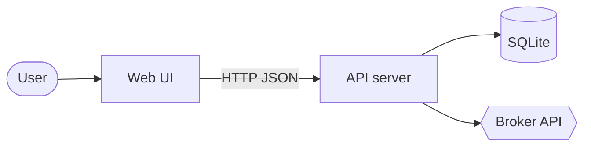
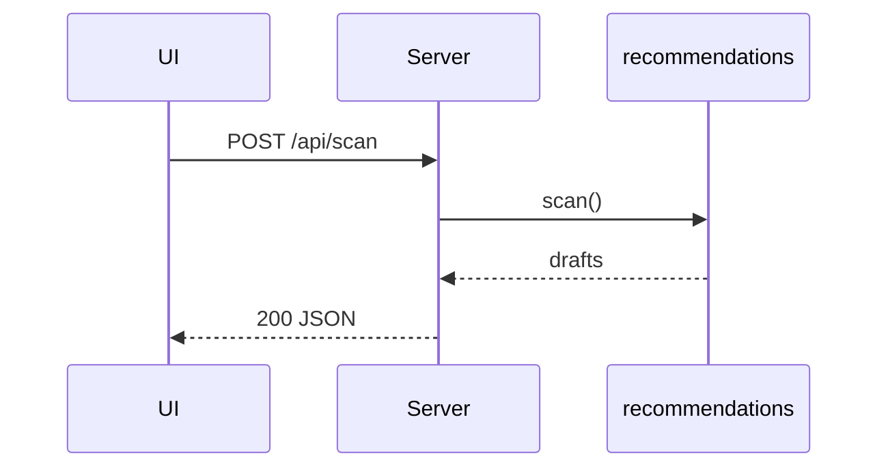

# Output templates by level

Use only the section you need. Replace angle-bracket text. Drop a heading when it has nothing true to say.

## L0 — Elevator

```
**<repo>** is a <shape: e.g. "Python CLI + local HTTP server with a React UI"> that <what it does, one clause>.
Stack: <languages (share)> · <frameworks> · <data store> · <deploy/runtime>.
Entry points: `<path>` (<role>), `<path>` (<role>).
Biggest part: `<module>` (<n> files) — <job>.
Confidence: [<score>] <basis>.
```

## L1 — System (containers)

```
## Shape
<1–2 sentences: architectural style and why you think so (evidence)>.
<If the multiple-systems check found more than one connected set: "This repo holds N separate systems: <A> (active, started by <launcher>) and <B> (<legacy/alternative>, inference: <evidence>). README describes <which>." Then group the table rows and the diagram subgraphs per system.>

## Runtime parts
| Part | Kind | Entry | Talks to | Evidence |
|---|---|---|---|---|
| <web UI> | SPA (React/Vite) | web/src/main.jsx | API over HTTP /api/* | main.jsx:31 fetch |

## External systems & data
- <Store/API/queue>: <how used> (`path:line`)

## Diagram


## Build, run, deploy
<commands from manifests/Makefile; CI; container/hosting>.

## Not visible from code
<blind spots>.

## Next zoom
- L2: ...
```

## L2 — Modules

```
## Layering
<e.g. "server/cli → recommendations/research → engine → data → contracts (pure helpers)">. Note violations and cycles.

## Modules
### `<module>` — <one-line job>
- Key files: `a.py` (<role>), `b.py` (<role>)
- Key symbols: `Foo` (path:line), `bar()` (path:line)
- Depends on: <modules> · Used by: <modules>
- Notes: <state it owns, side effects, I/O, notable patterns>

## Module diagram
<mermaid from the digest, pruned to ≤12 nodes, utilities collapsed into one "shared" node>

## Shared utilities
<list; one line each>

## Health signals
<cycles, god modules (huge fan-in+fan-out), dead/orphan modules, test coverage shape>
```

## L3 — Flows

Pick flows from entry points: the main user request, the main background job, and the main CLI command. For each:

```
### Flow: <name> (trigger: <HTTP POST /x | cron | CLI `cmd`>)
1. `server.py:122` `do_POST` parses body, routes `/scan`.
2. `recommendations.py:44` `scan()` loads universe via `data.universe()` (`data.py:85`).
3. ...
Data touched: <tables/files/keys>. Side effects: <writes, network>. Failure handling: <what happens on error>.


```

## L4 — Deep dive (focus area)

```
## Purpose and boundary
<what the area owns; public surface (exported functions/classes/routes)>.

## Internals
- Core types/data structures with fields that matter (path:line).
- Algorithms/state machines; invariants the code enforces (cite the checks).
- Concurrency, caching, persistence, error model.

## Interactions
<callers and callees outside the area; graphify path / codegraph evidence>.

## Extension points
<where to add a new X; registries, interfaces, config>.

## Risks and smells
<tight coupling, missing tests, TODO/FIXME, security-sensitive spots>. Mark opinions as such.
```
